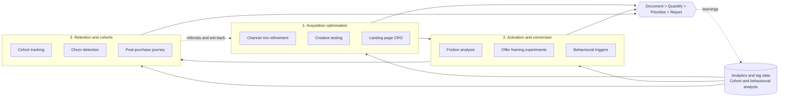

# Full-funnel system map

The map below is the backbone of the backlog. Every experiment is attached to one stage and one primary metric, and every stage has a guardrail metric from the stage after it, so a win in one place cannot quietly create a loss downstream.

## Stages, metrics and levers

| Stage | Primary metrics | Guardrail metric | Typical levers |
|---|---|---|---|
| Acquisition | Cost per qualified visit, landing conversion rate, cost per lead | Lead-to-order rate (stops cheap, low-intent traffic from looking like a win) | Channel mix, audiences, creative angle, landing page structure, message match |
| Activation and conversion | Checkout start rate, checkout completion rate, order rate per qualified visitor | 30-day cancellation rate | Form length, address and eligibility check, plan comparison, offer framing, trust signals, nudges at drop-off |
| Retention and cohorts | Month-n retention, churn rate, revenue retention, contact-centre contacts per customer | Margin per customer (stops retention offers that buy loyalty at a loss) | Onboarding, installation experience, first-bill clarity, proactive service messages, renewal offers |

## The growth loop

1. Data shows where the funnel leaks (diagnostic).
2. The leak becomes a hypothesis, documented and quantified.
3. The backlog is prioritised across all three stages together.
4. The test runs; the readout goes to stakeholders with a business implication.
5. The learning updates the map and the next round of diagnostics.

A "loop" is only real if step 5 happens. Keep a running learnings log (one line per finished test) linked from the backlog.
