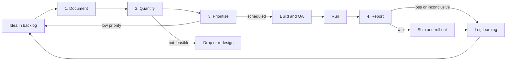

# Experiment lifecycle: document, quantify, prioritise, report

Every experiment passes through the same four steps, plus build and run. Skipping a step is allowed only when it is written down why.



## 1. Document

Fill `templates/experiment-brief.md`. Minimum fields:

- Observation and evidence (links to data, recordings, quotes)
- Hypothesis in the standard format
- Primary metric, secondary metrics, guardrail metrics
- Audience and exclusion rules
- Variants, with screenshots or copy
- Decision rule: what happens on win, loss, inconclusive

**Exit criterion:** a peer who did not write the brief can explain what is being tested and why.

## 2. Quantify

- Baseline rate for the primary metric over the last four to eight weeks
- Minimum detectable effect (MDE), relative and absolute
- Sample size per variant at the chosen significance and power (default 95% / 80%)
- Expected duration given eligible traffic, rounded up to full weeks to cover weekday effects
- Expected value: customers or revenue per month if it wins

```bash
python3 scripts/abtest.py size --baseline 0.031 --mde 0.12 --daily-traffic 4200
```

**Exit criterion:** the test can reach its sample within the maximum duration (default four weeks). If not, redesign or drop.

## 3. Prioritise

Score with ICE or impact vs effort (see `04-prioritization-ice-impact-effort.md`) and place it in the shared backlog. Check for collisions: two tests on the same page or audience at the same time must be mutually exclusive or explicitly designed as a multivariate test.

**Exit criterion:** scheduled with an owner, a start date and a stop date.

## Build and run

- QA every variant on the main devices and browsers before launch
- Check the split is balanced after 24 hours (sample ratio mismatch check: a chi-square p-value under 0.001 means stop and investigate)
- Do not peek-and-stop. Decide at the planned sample unless a guardrail breaks
- Log anything that happened during the test (outages, campaigns, price changes)

## 4. Report

Fill `templates/results-readout.md` within two working days of the stop date.

- Result on the primary metric with confidence interval, not just a p-value
- Guardrails and secondary metrics
- Segment cuts only if they were pre-registered; anything else is labelled exploratory
- Business implication in one sentence: what it is worth per month and what we will do
- Learning: what this tells us about customers, whether it won or lost

```bash
python3 scripts/abtest.py test --control 412 13250 --variant 489 13310
```

**Exit criterion:** the decision is made and recorded in the backlog, and the learnings log has one new line.

## Roles

| Role | Responsibility |
|---|---|
| Experiment owner | Brief, coordination, readout |
| Analyst | Quantification, QA of tracking, analysis |
| Designer / engineer | Variants and build |
| Stakeholder (product, marketing, sales) | Reviews brief, receives readout, owns the rollout decision |
